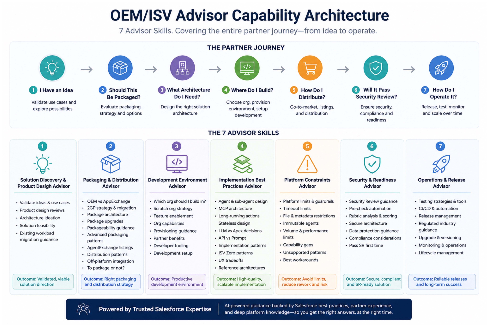
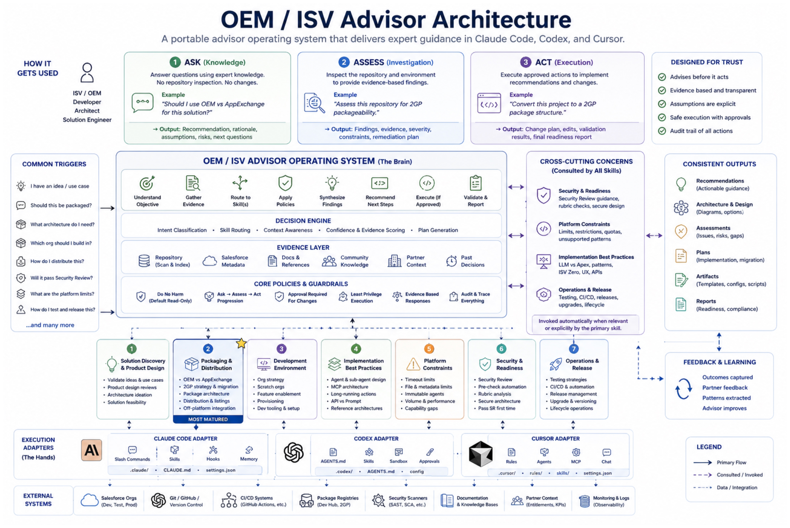

# OEM/ISV Advisor architecture

This repository delivers one installable **ISV/OEM Advisor** for Salesforce
partners that resell, extend, embed, or distribute Salesforce solutions. The
advisor meets the partner wherever they are in the journey and routes each
decision through a stable operating system and capability library.

## Product architecture

The installed advisor contains five layers:

1. **Partner entrance:** `$oem-isv-advisor` preserves the partner's goal and
   identifies the next decision regardless of lifecycle stage.
2. **Operating system:** understand the objective, select Ask/Assess/Act,
   gather evidence, route skills, apply policy, synthesize findings, recommend
   next steps, execute only when approved, and validate outcomes.
3. **Evidence and guardrails:** practitioner knowledge, partner context,
   repositories, Salesforce metadata, documentation, prior decisions, explicit
   evidence labels, least privilege, and an audit trail.
4. **Seven partner capabilities:** the complete journey from idea to operate.
5. **Execution adapters:** thin Codex, Claude Code, and Cursor integration that
   delegates approved Salesforce build, deploy, CLI, MCP, and external-system
   actions to the appropriate tool libraries.

The advisor is the product. Capability routers and focused skills are its
internal library; partners do not install or compose them separately.

## Baseline contract

The baseline contains **27 skill folders**:

- 2 foundation skills: entry routing and documentation/tool preflight.
- 7 capability routers: one for each stage of the partner journey.
- 18 focused advisors currently assigned to Capabilities 2, 3, and 4.

A skeleton is not a production-readiness claim. It establishes the stable skill
ID, triggering boundary, capability ownership, supported modes, evidence rules,
and execution delegation. This allows the whole advisor to ship coherently
while each capability gains deeper practitioner knowledge and validated
procedures over time.

## Ask, Assess, and Act

- **Ask — knowledge:** answer and guide from supplied context and packaged
  expertise without inspecting repositories or systems.
- **Assess — investigation:** inspect explicitly approved artifacts and
  environments read-only and return evidence-backed findings.
- **Act — execution:** propose a bounded plan and require explicit approval
  before material file, org, package, deployment, installation, or external
  system changes.

All three modes return a consistent partner readout: recommendation, rationale,
evidence, assumptions, risks, unknowns, confidence, next questions, and the next
approved action.

## Capability map

| # | Capability router | Decision ownership | Focused skills |
|---|---|---|---:|
| 1 | `solution-discovery` | Product fit, target user, product boundary, Salesforce fit, and viable direction | 0 |
| 2 | `packaging-distribution` | Packaging, package lifecycle, upgrades, listings, and distribution | 7 |
| 3 | `development-environment` | Development, test, demo, trial, customer-test, and packaging environments | 5 |
| 4 | `implementation-best-practices` | Scalable implementation patterns after product and environment decisions | 6 |
| 5 | `platform-constraints` | Limits, metadata support, guardrails, capability gaps, and workarounds | 0 |
| 6 | `security-readiness` | Secure architecture, review preparation, evidence, and remediation readiness | 0 |
| 7 | `operations-release` | Testing, CI/CD, release, rollback, monitoring, support, and lifecycle operations | 0 |

## Complete skill inventory

### Foundation

- `oem-isv-advisor` — partner goal owner and entry router.
- `advisor-capability-preflight` — documentation, source, and tool preflight.

### Capability 1 — Solution Discovery

- `solution-discovery` — capability router.

### Capability 2 — Packaging and Distribution

- `packaging-distribution` — capability router.
- `packaging-strategy`
- `packageability-assessment`
- `managed-2gp-foundation`
- `package-version-validation`
- `package-ancestry-dependencies`
- `package-release-promotion`
- `package-migration-transfer`

### Capability 3 — Development Environment

- `development-environment` — capability router.
- `pbo-dev-hub-foundation`
- `namespace-access-governance`
- `scratch-org-shape`
- `environment-portfolio`
- `org-provisioning-diagnostics`

### Capability 4 — Implementation Best Practices

- `implementation-best-practices` — capability router.
- `implementation-pattern-router`
- `headless-mcp-advisor`
- `agentforce-implementation-advisor`
- `data-360-implementation-advisor`
- `slack-implementation-advisor`
- `tableau-next-implementation-advisor`

### Capability 5 — Platform Constraints

- `platform-constraints` — capability router.

### Capability 6 — Security and Readiness

- `security-readiness` — capability router.

### Capability 7 — Operations and Release

- `operations-release` — capability router.

The machine-readable ownership, modes, dependencies, maturity, and primary or
supporting relationships live in
`skills/oem-isv-advisor/references/capability-catalog.json`.

## Capability maturity

The complete architecture remains present in every release even when skill
depth differs. Capability 2 and Capability 3 are the current active maturation
areas; Capability 4 now has a Headless MCP specialist. Other capabilities retain
honest baseline behavior and explicitly label knowledge gaps rather than
disappearing from the partner experience.

Maturing a skill adds reviewed practitioner knowledge, scenarios, references,
and validated behavior inside its stable folder. Adding a capability outside
this map requires an architecture decision; improving depth does not restructure
the partner product.

Practitioner knowledge changes are product changes even when no skill is added.
Workaround, order-of-operations, factual, product-evolution, documentation-
alignment, and deprecation updates retain provenance and supersession lineage,
identify affected skills and partner decisions, and rerun affected scenarios.
Public documentation corroborates, qualifies, scopes, or conflicts with the
field pattern; documentation silence does not erase reviewed practitioner
guidance. See
`skills/oem-isv-advisor/references/practitioner-knowledge-policy.md`.

## Runtime rules

- Route by the partner decision, not by document title or product keyword.
- The primary skill owns the final recommendation and includes supporting
  findings.
- Ask is context-only; Assess is read-only inspection; Act requires a bounded
  plan and explicit approval before material changes.
- Label evidence and uncertainty. Never claim an inaccessible source was
  reviewed or state current limits and policy from memory.
- Delegate build, deploy, Salesforce CLI, and MCP execution to approved tool
  libraries rather than reproducing them in advisory skills.
